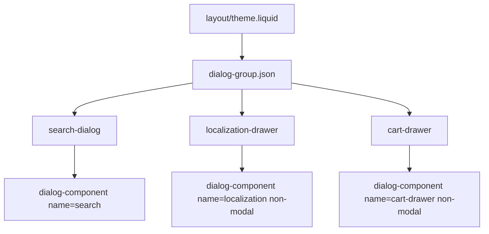
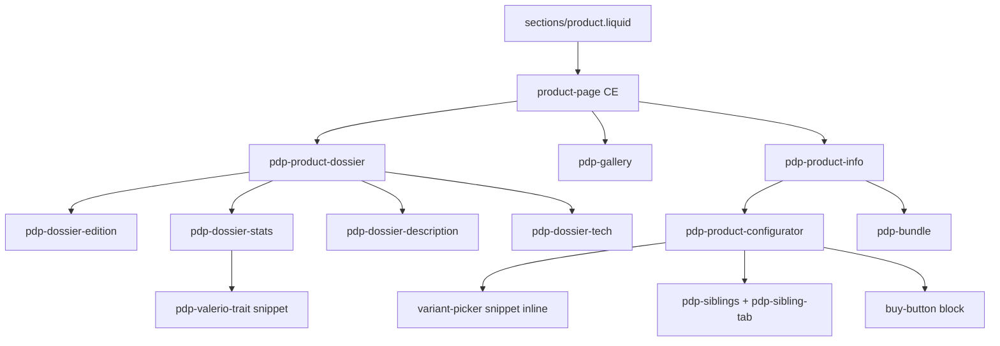

# Ricette componenti

Cookbook end-to-end per le feature del tema. Per convenzioni trasversali vedi [11-javascript.md](11-javascript.md), [12-css.md](12-css.md), [13-liquid-html.md](13-liquid-html.md).

## Indice ricette

1. [Dialog e drawer](#dialog-e-drawer)
2. [Search dialog](#search-dialog)
3. [Localization drawer](#localization-drawer)
4. [PDP — blocchi e albero](#pdp--blocchi-e-albero)
5. [Siblings PDP](#siblings-pdp)
6. [Siblings product card](#siblings-product-card)
7. [Variant picker](#variant-picker)
8. [Buy button e cart](#buy-button-e-cart)
9. [Bundle fusion](#bundle-fusion)
10. [Collection filters](#collection-filters)
11. [Product card](#product-card)
12. [Deferred carousel](#deferred-carousel)
13. [Schema.org](#schemaorg)

---

## Dialog e drawer

### Albero dialog-group

### File

- `assets/Dialog.js` — `DialogComponent`, `DialogOpener`
- `assets/components.css` — `.drawer`, `.from-*`
- `sections/search-dialog.liquid`, `localization-drawer.liquid`, `cart-drawer.liquid`
- `sections/dialog-group.json`

### Ricetta

1. Section con host `dialog-component` + `name` univoco.
2. `<dialog ref="dialog" id="{name}" class="drawer from-right …">`.
3. Drawer non-modale: `non-modal` sull'host → `dialog.show()` invece di `showModal()`.
4. Open header: `commandfor="{name}" command="show-modal"`.
5. Close: `commandfor="{name}" command="request-close"`.
6. Overlay drawer: `body:has(.classe-drawer[open])::after` nel `` della section.
7. Apertura da JS: `DialogComponent.showModal('cart-drawer')`.
8. Mutua esclusione: automatica via `dialog:opened` — ogni dialog si chiude da solo.

**Non fare:** `on:click` su open/close; `closeOthers()` con loop; fallback click senza Invoker Commands.

---

## Search dialog

### File

- `sections/search-dialog.liquid` — host `search-dialog` (modale)
- `snippets/search-dialog-initial.liquid` — stato iniziale, chips, featured
- JS in modulo search (registrato via `global.js`)

### Ricetta

1. `<search-dialog name="search">` con `<dialog ref="dialog" id="search" class="search-dialog">`.
2. Form con `on:submit` o input `on:input` per query live.
3. `ref` per aree dinamiche (`suggestions`, risultati).
4. Apertura: bottone header `commandfor="search"` + shortcut `DialogComponent.showModal('search')`.
5. Modale (senza `non-modal`): backdrop nativo + Esc nativo.

---

## Localization drawer

### File

- `sections/localization-drawer.liquid`
- CE `localization-form` con `on:input="handleInput"`

### Ricetta

1. `dialog-component name="localization" non-modal`.
2. `` con hidden `country_code` / `language_code` e `ref` sugli input.
3. Lista paesi/lingue renderizzata server-side; filtro client con `on:input` su search.
4. Submit form Shopify per cambio mercato/lingua.

---

## PDP — blocchi e albero

### Albero PDP

### File

| Area | File |
|---|---|
| Section | `sections/product.liquid`, `sections/product-breadcrumb.liquid` |
| Blocks | `pdp-product-dossier`, `pdp-gallery`, `pdp-product-info`, `pdp-dossier-*` |
| JS | `assets/Product.js` (`ProductPage`), `assets/PdpSiblings.js` |
| Snippet | `snippets/pdp-valerio-trait.liquid` |

### Ricetta nuova parte PDP

1. Preferisci **block** se configurabile in editor; snippet solo per frammento interno.
2. Monta in `product.liquid` con ``.
3. Altezze sticky/mobile: custom properties da `ProductPage` (`assets/Product.js`), non layout JS invasivo.
4. CSS nested sotto `product-page` o classe block scoped.
5. Prefisso `pdp-` per componenti scoped al dominio prodotto.

---

## Siblings PDP

### File

- `assets/ColorSibling.js`, `assets/PdpSiblings.js`, `assets/GraphQL.js`
- `blocks/pdp-sibling-tab.liquid` — solo tag + label editor
- Tab e chip in `blocks/pdp-product-info.liquid`

### Ricetta

1. Tab configurabili come blocchi `pdp-sibling-tab` dentro `pdp-siblings`.
2. JS: `ColorSibling.get(tag, limit)` — **non** duplicare query GraphQL.
3. Template chip e layout restano Liquid; JS popola e gestisce selezione.
4. Cache in `sessionStorage` gestita da `ColorSibling`.

---

## Siblings product card

### File

- `blocks/product-card.liquid`, `snippets/product-card*.liquid`
- `assets/ProductCard.js`
- `templates/product.card.liquid` — partial `view=card`

### Ricetta

1. Swatches in `snippets/product-card-swatches.liquid`.
2. Click swatch → fetch partial `?view=card` → `DOMParser` → `updateRef` su refs specifici.
3. Mantieni server-render iniziale; swap solo le parti necessarie.
4. Stesso `ColorSibling` per dati sibling, stesso limite configurabile.

---

## Variant picker

### File

- `blocks/pdp-product-configurator.liquid` — render inline con `source: 'pdp'`
- `blocks/variant-picker.liquid` — wrapper globale (senza source)
- `snippets/variant-picker.liquid` — markup opzioni
- `sections/product.liquid` — setting `preselect_variant`
- `assets/Product.js` — `VariantPicker`, `OnVariantSelectedEvent`, section rendering

### Ricetta PDP

1. Section `product` risolve `variant` una volta (`selected_variant`, fallback first available se preselect ON).
2. Configurator: ``.
3. Block figli: `assign current_variant = variant | default: closest.variant` — niente logica preselect locale.
4. Selezione completa → `OnVariantSelectedEvent` → section render aggiorna `price`, `galleryPrice`, `buyButton`.
5. Bootstrap JS: `data-preselect-variant-id` quando preselect ON e URL senza variant.
6. Default-only: picker nascosto; `selected_variant` da Shopify.

### Buy button stati

| Stato | Condizione |
|---|---|
| `select-size` | Multi-variante, `current_variant` blank |
| `sold-out` | Variante selezionata, non disponibile |
| `add` | Variante selezionata e disponibile |

`current_variant` nei block PDP = `variant | default: closest.variant` (risolto in section).

---

## Buy button e cart

### File

- `blocks/buy-button.liquid` — `product-form on:submit="onSubmit"`
- `assets/Cart.js` — `CartHandler`, `ProductForm`, `CartDrawer`, `CartItem`
- `sections/cart-drawer.liquid`

### Ricetta add-to-cart

1. `` dentro `<product-form on:submit="onSubmit">`.
2. `ProductForm.onSubmit` → `CartHandler.add(formData)`.
3. Post-success: `DialogComponent.showModal('cart-drawer')` + eventi `OnCartUpdateEvent`.
4. `CartDrawer` ascolta eventi cart e aggiorna `ref="count"`, `ref="body"`, `ref="subtotal"`.
5. Righe dinamiche: `ref="itemTemplate"` + `cart-item` con `on:click` increase/decrease/remove.

### Ricetta cart drawer

1. `dialog-component` + `cart-drawer` CE con `data-section-id`.
2. Body iniziale server-render; refresh async via Section Rendering su update.
3. `CartHandler` unico punto per Ajax Cart API — non fetch `/cart.js` diretto altrove.

---

## Bundle fusion

### File

- `blocks/pdp-product-info.liquid` — JSON bundle
- `assets/Cart.js` — `PdpBundle`
- `snippets/bundle-fusion-line-item.liquid`

### Ricetta

1. JSON configurazione in `ref="bundleData"` (o `data-*` equivalente).
2. Add to cart: più line item con proprietà `_bundleId` condiviso.
3. Cart drawer: `item.item_components` → render `bundle-fusion-line-item`.
4. Collegamento righe via proprietà cart Shopify, non stato globale JS.

---

## Collection filters

### File

- `sections/collection.liquid`, `blocks/filters.liquid`, `snippets/filters.liquid`
- `templates/collection.grid.liquid`, `templates/collection.filters.liquid`
- `assets/Collection.js`

### Ricetta

1. Filtri in drawer `dialog-component` non-modale (`drawer_id` collection/search).
2. Submit filtri → `OnFiltersApplyEvent`.
3. Griglia ascolta → fetch partial view → replace contenuto.
4. Prima di aggiungere stato JS: verifica se input + `:has()` + attributi bastano.
5. `DialogComponent.showModal` per aprire drawer filtri da header/collection.

---

## Product card

### File

- `blocks/product-card.liquid` — compone `product-card-media` + `product-card-info`
- `snippets/product-card.liquid` — wrapper `<product-card>`

### Ricetta

1. `` per sotto-blocchi media e info.
2. ``.
3. CE `product-card` per swap sibling async (vedi [Siblings product card](#siblings-product-card)).
4. Usata in collection, search, carousel recommendations con stesso block type.

---

## Deferred carousel

### File

- `sections/product-recommendations-carousel.liquid`
- `assets/DeferredSection.js`
- `snippets/deferred-section-skeleton.liquid`, `snippets/swiper.liquid`
- `assets/swiper-element-bundle.min.js`

### Ricetta

1. Section fuori viewport o non critica → `<deferred-section>` con URL fetch (`routes.product_recommendations_url` + `section_id`, `product_id`, `limit`, `intent`).
2. Skeleton con dimensioni fisse per evitare layout shift (righe visibili = righe skeleton).
3. Post-fetch: inietta HTML section; card via ``.
4. Swiper caricato solo quando la section entra in scope.

---

## Schema.org

### File

- `blocks/schema-organization.liquid`
- `blocks/schema-store.liquid`, `schema-store-opening-hours.liquid`, `schema-store-contact-points.liquid`
- `blocks/schema-contact-point.liquid`, `schema-opening-hours.liquid`

### Ricetta

1. Block JSON-LD componibili montati in footer o layout via theme blocks.
2. Dati da `shop` / settings block — tutto server-side, zero JS.
3. Un block per entità (Organization, Store, OpeningHoursSpecification, ContactPoint).
4. Nested blocks per orari e contact points multipli.

---

## Quando aprire una ricetta

| Task | Ricetta |
|---|---|
| Nuovo drawer | [Dialog e drawer](#dialog-e-drawer) |
| Feature PDP | [PDP](#pdp--blocchi-e-albero) + ricetta specifica |
| Async lista prodotti | [Product card](#product-card) o [Deferred carousel](#deferred-carousel) |
| Interazione carrello | [Buy button e cart](#buy-button-e-cart) |
| SEO strutturato | [Schema.org](#schemaorg) |

Indice file grezzo: [20-feature-map.md](20-feature-map.md).
